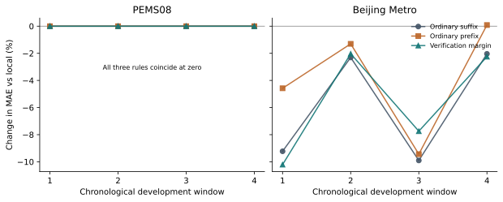

# When should a city trust a transferred traffic forecast?

Working manuscript · 23 November 2026 · Target journal: *Nature Communications*. This draft reports exposed development evidence. The Results section below the insertion marker is populated by the pinned CPU campaign. Authorship, affiliations, funding and declarations require author confirmation.

## Abstract

A city with limited observations must decide whether a forecast learned elsewhere adds value to a locally fitted predictor. We study the difference between producing a useful forecast and identifying that benefit before deployment. We first evaluated eight public checkpoints from a multimodal traffic forecasting study. Five matched the three published joint-training metrics at the displayed precision. We then compared local and transferred forecasts under a common chronological protocol. All 132 learned cases from the initial ordinary-transfer experiment had higher errors than their matched local predictors. A persistence-anchored model trained for early evidence of improvement reduced unconditional mean absolute error from 50.670 to 47.373 in Beijing Metro in the first development pilot. The prespecified sequential rule retained the local forecast in every pilot case. Four additional windows in each development domain showed that an empirical full-window decision could select beneficial and harmful transfers. These results motivate a held-out comparison of source objectives, verification rules and partial forecast corrections under the same target-label budget. The six-domain estimates are required before drawing conclusions about generalization.

## Introduction

A transport operator with little recent local training data might benefit from the recurring traffic patterns learned in another city. Deployment introduces a second question. Can the operator identify a useful correction before the decision takes effect, using only the observations already available? A good transfer forecast can be discarded when the available evidence is insufficient. Conversely, a rule that switches frequently may amplify errors if the local and transferred models diverge in a new regime.

LLM-UTP studied joint training across modes followed by target-specific adaptation [1]. OpenCity studied cross-region transfer with a spatiotemporal foundation model [2]. These studies motivate controls that distinguish the benefits of shared training from the gains attributable to how a forecast is deployed. Sequential forecast comparison characterizes evidence about historical conditional loss differences [3,4]. Combination methods can reduce dependence on selecting a single forecaster [5]. We bring these questions together in a target-excluded experiment that holds the deployment rule fixed while changing the objective used to train the transfer candidate.

## Methods

We retained eight public processed transport arrays and forecast the next row from the preceding 12 rows. PEMS08 and Beijing Metro were development domains. PEMS03, PEMS04, Shanghai Metro, Hangzhou Metro, NYC bike and NYC taxi were held out of the corresponding source fits. The two NYC targets share a source fold. Their previous ordinary-transfer results were visible before the six-domain method specification. New objective scores remained sealed at the time of the amendment. Data ordered by row support a one-step evaluation under assumed next-row observation availability. Missing physical timestamps limit claims about sensor latency or real-time deployment.

The 5% budget refers to a fraction of the pre-test period. The contract divides this allowance between target support for fitting and subsequent verification for decisions. For each seed, a support-only selection procedure chose among persistence, ridge regression and a compact transformer. The anchored candidate predicts a correction to the last observed value. Source training compares ordinary suffix MAE, suffix plus prefix MAE, and suffix plus a verification-margin term computed on the same prefix labels. Each comparison uses the same frozen target comparator, scaler, forecast origins and physical units. Seeds are 11, 22 and 33.

The original primary comparison is the margin-trained candidate against the prefix-MAE candidate under the same two-sided stopping rule. Each forecast is fixed at its issue time. The score difference is the transfer MAE minus local MAE divided by the support scale. The sequential rule accepts when the upper confidence bound is strictly below −0.01 after at least 12 rows. Its probabilistic interpretation concerns a single stream's average conditional loss difference over the observed prefix [3,4]. Test-period accuracy and harm are measured empirically.

The prospective amendment tests partial corrections after two-thirds of the verification block. The weight on transfer is selected from 0, 0.25, 0.5, 0.75 and 1 using mean verification MAE divided by the support scale plus 0.01 times the weight. Ties return the smaller weight. The endpoints reproduce the empirical binary rule's gain requirement. Controls include a blind equal blend, both ordinary objectives, ordinary Qwen and a shared-protocol LLM-UTP adaptation. The ablation measures whether extra weights or the training objective explain any gains. The continuous-valued outcome remains a chronological point forecast. The estimated weight remains fixed throughout the test block.

## Results

The reference assessment verified 37 released assets and evaluated eight public checkpoints. PEMS03, PEMS08, Hangzhou, bike and taxi matched the reported S1 rounded MAE, RMSE and WMAPE. Differences persisted for PEMS04, Shanghai and Beijing. Public availability of eight full datasets limits complete recreation of the authors' eleven-domain joint training. The reference evaluator preserves the released batching and scaling behavior. The new evaluation uses a common chronological protocol.

On PEMS08 the verification-trained candidate had mean development MAE 16.311 versus 14.717 locally. On Beijing Metro the corresponding errors were 47.373 and 50.670. The locked decision rule retained local in all 18 pilot cases and consumed the full available verification block. Across four additional Beijing windows, a full-window empirical rule with the margin objective achieved mean MAE 47.536 versus local 50.435. It selected eight beneficial and one harmful transfer in 12 paired seed-window cases. The ordinary suffix objective with the same rule reached 47.372, with six beneficial selections and zero harmful selections. These exploratory observations informed the amendment and must remain separate from the six-domain comparisons.

*Figure 1. Equal weighting of three seeds within each development window. Values below zero indicate lower MAE than the local model. Curves use the full-window empirical rule. All PEMS08 series coincide at zero.*

<!-- CAMPAIGN_RESULTS -->

## Interpretation and limits

The development results show why unconditional accuracy alone gives an incomplete picture of deployment. We distinguish three observable events: the candidate improves future test MAE, the boundary is mathematically reachable along the realized forecast path, and the accrued evidence selects it. Reachability alone cannot establish that the hypothetical labels or future traffic regime are attainable. A secondary common-row comparison against the original checkpoints can answer which forecast had lower error on those observations. Different training access, full-array scaling and original batch dependence preclude an equal-information causal comparison.

The study conditions on six particular targets and three paired seeds. Resampling includes dependence along rows and preserves the shared NYC fold. Short panels, limited independent time blocks, exposure to ordinary baselines and uncertainty about physical timestamps constrain generalization. Combining forecasts and sequential inference both have substantial prior literature. Any methodological contribution rests on gains beyond their matched controls. Language-model-specific claims would additionally require a matched backbone ablation [6].

## Data and code

Code and experiment specifications are available at https://github.com/rtqayyum/nature-llm. Reference data and author code are available at https://doi.org/10.5281/zenodo.19503648. The project records aggregate outputs and the identifiers of the forecast and observation artifacts used for scoring.

## References

1. Zhang, J. et al. A scalable and generic framework for city-wide traffic prediction with large language model. *Nature Communications* 17, 7466 (2026). https://doi.org/10.1038/s41467-026-73610-2
2. Li, Z. et al. OpenCity: Open Spatio-Temporal Foundation Models for Traffic Prediction. https://arxiv.org/abs/2408.10269
3. Choe, Y. J. & Ramdas, A. Comparing Sequential Forecasters. *Operations Research* 72, 1368–1387. https://doi.org/10.1287/opre.2021.0792
4. Howard, S. R., Ramdas, A., McAuliffe, J. & Sekhon, J. Time-uniform, nonparametric, nonasymptotic confidence sequences. *Annals of Statistics* 49, 1055–1080 (2021). https://doi.org/10.1214/20-AOS1991
5. Wang, X., Hyndman, R. J., Li, F. & Kang, Y. Forecast combinations: An over 50-year review. *International Journal of Forecasting* 39, 1518–1547 (2023). https://doi.org/10.1016/j.ijforecast.2022.11.005
6. Tan, M. et al. Are Language Models Actually Useful for Time Series Forecasting? *NeurIPS* 37 (2024). https://proceedings.neurips.cc/paper_files/paper/2024/hash/6ed5bf446f59e2c6646d23058c86424b-Abstract-Conference.html
