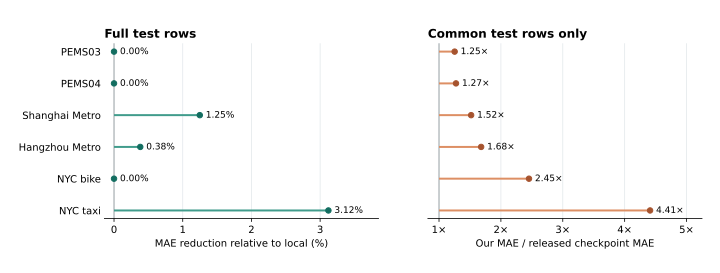

# When should a city trust a transferred traffic forecast?

Working manuscript · 23 November 2026 · Target journal: *Nature Communications*. This version incorporates the completed six-domain campaign at the precision printed by HPC job 3111109. Per-seed and sensitivity results await reconciliation with the aggregate archive. Authorship, affiliations, funding and declarations require author confirmation.

## Abstract

A transport operator with limited local data faces two decisions: whether forecasts learned in other cities are useful and how much to rely on them. We studied these decisions on eight public traffic datasets using chronological target observations. Two domains informed method development. On six held-out domains, we compared a predictor trained to demonstrate an early advantage over a local model with a predictor trained on the same prefix observations using ordinary forecast error. Under the prespecified sequential rule, the difference in deployed mean absolute error (MAE) was 0.00 percentage points of local MAE at reported precision. A prespecified secondary rule estimated a single weight on the transferred correction using two-thirds of the verification period. It reduced MAE by 0.79% on average relative to local forecasting, with a descriptive paired 95% interval of 0.74–0.83% across resampled time blocks of these six datasets. Gains were concentrated in NYC taxi and Shanghai Metro. The improvement over an identically weighted ordinary suffix-trained predictor was 0.11 percentage points of local MAE. Released LLM-UTP checkpoints attained lower MAE on comparable observations in every held-out domain under their original training and evaluation conditions. These results identify a modest benefit from partial transfer under limited supervision and show how strongly its magnitude depends on the local setting and comparison model.

## Introduction

A transport operator with little recent local training data might benefit from the recurring traffic patterns learned in another city. Deployment introduces a second question. Can the operator identify a useful correction before the decision takes effect, using only the observations already available? A good transfer forecast can be discarded when the available evidence is insufficient. Conversely, a rule that switches frequently may amplify errors if the local and transferred models diverge in a new regime.

LLM-UTP studied joint training across modes followed by target-specific adaptation [1]. OpenCity studied cross-region transfer with a spatiotemporal foundation model [2]. These studies motivate controls that distinguish the benefits of shared training from the gains attributable to how a forecast is deployed. Sequential forecast comparison characterizes evidence about historical conditional loss differences [3,4]. Combination methods can reduce dependence on selecting a single forecaster [5]. We bring these questions together in a target-excluded experiment that holds the deployment rule fixed while changing the objective used to train the transfer candidate.

## Methods

We retained eight public processed transport arrays and forecast the next row from the preceding 12 rows. PEMS08 and Beijing Metro were development domains. PEMS03, PEMS04, Shanghai Metro, Hangzhou Metro, NYC bike and NYC taxi were held out of the corresponding source fits. The two NYC targets share a source fold. Their previous ordinary-transfer results were visible before the six-domain method specification. New objective scores remained sealed at the time of the amendment. Data ordered by row support a one-step evaluation under assumed next-row observation availability. Missing physical timestamps limit claims about sensor latency or real-time deployment.

The 5% budget refers to a fraction of the pre-test period. The contract divides this allowance between target support for fitting and subsequent verification for decisions. For each seed, a support-only selection procedure chose among persistence, ridge regression and a compact transformer. The anchored candidate predicts a correction to the last observed value. Source training compares ordinary suffix MAE, suffix plus prefix MAE, and suffix plus a verification-margin term computed on the same prefix labels. Each comparison uses the same frozen target comparator, scaler, forecast origins and physical units. Seeds are 11, 22 and 33.

The original primary comparison is the margin-trained candidate against the prefix-MAE candidate under the same two-sided stopping rule. Each forecast is fixed at its issue time. The score difference is the transfer MAE minus local MAE divided by the support scale. The sequential rule accepts when the upper confidence bound is strictly below −0.01 after at least 12 rows. Its probabilistic interpretation concerns a single stream's average conditional loss difference over the observed prefix [3,4]. Test-period accuracy and harm are measured empirically.

The prospective amendment tests partial corrections after two-thirds of the verification block. The weight on transfer is selected from 0, 0.25, 0.5, 0.75 and 1 using mean verification MAE divided by the support scale plus 0.01 times the weight. Ties return the smaller weight. The endpoints reproduce the empirical binary rule's gain requirement. Controls include a blind equal blend, both ordinary objectives, ordinary Qwen and a shared-protocol LLM-UTP adaptation. The ablation measures whether extra weights or the training objective explain any gains. The continuous-valued outcome remains a chronological point forecast. The estimated weight remains fixed throughout the test block.

## Results

The reference assessment verified 37 released assets and evaluated eight public checkpoints. PEMS03, PEMS08, Hangzhou, bike and taxi matched the reported S1 rounded MAE, RMSE and WMAPE. Differences persisted for PEMS04, Shanghai and Beijing. Public availability of eight full datasets limits complete recreation of the authors' eleven-domain joint training. The reference evaluator preserves the released batching and scaling behavior. The new evaluation uses a common chronological protocol.

On PEMS08 the verification-trained candidate had mean development MAE 16.311 versus 14.717 locally. On Beijing Metro the corresponding errors were 47.373 and 50.670. The locked decision rule retained local in all 18 pilot cases and consumed the full available verification block. Across four additional Beijing windows, a full-window empirical rule with the margin objective achieved mean MAE 47.536 versus local 50.435. It selected eight beneficial and one harmful transfer in 12 paired seed-window cases. The ordinary suffix objective with the same rule reached 47.372, with six beneficial selections and zero harmful selections. These exploratory observations informed the amendment and must remain separate from the six-domain comparisons.

*Figure 1. Equal weighting of three seeds within each development window. Values below zero indicate lower MAE than the local model. Curves use the full-window empirical rule. All PEMS08 series coincide at zero.*

### Six held-out domains

Under the registered two-sided rule, the margin-minus-prefix contrast in deployed MAE was +0.00 percentage points of local MAE at the reported precision. The locked margin arm matched the displayed local MAE on every domain. The secondary weighted margin rule reduced equal-domain MAE by 0.79 percentage points of local MAE (descriptive 95% paired interval for the reduction, 0.74–0.83 points, 144-row blocks). This fell below the 2-point practical benchmark specified for the manuscript. Holding the margin-trained forecasts and verification budget fixed, allowing interior weights improved on the two-thirds binary decision by 0.36 points (0.30–0.41). Holding the weighting rule fixed, margin training improved on prefix training by 0.58 points (0.53–0.62) and on suffix training by 0.11 points (0.05–0.16).

| Domain | Local MAE | Weighted margin MAE | Relative reduction | Verification rows consulted by the weighted rule |
|---|---:|---:|---:|---:|
| PEMS03 | 13.679 | 13.679 | 0.00% | 350 |
| PEMS04 | 18.732 | 18.732 | 0.00% | 227 |
| Shanghai Metro | 49.746 | 49.125 | 1.25% | 81 |
| Hangzhou Metro | 45.565 | 45.391 | 0.38% | 22 |
| NYC bike | 9.076 | 9.076 | 0.00% | 117 |
| NYC taxi | 75.857 | 73.490 | 3.12% | 117 |

NYC taxi accounted for approximately 66% of the equal-domain reduction. Excluding both NYC datasets left an estimated 0.41% reduction over the remaining four domains. These calculations use rounded domain MAEs. The weighted rule used its prescribed verification allowance even where the displayed test MAEs tied. Four of 18 unconditional margin candidates achieved lower test MAE than local. In all four cases the sequential threshold was mathematically reachable under maximally favorable hypothetical labels along the realized sequence of forecast pairs.

### Comparison with LLM-UTP

Our weighted margin method improved on the weighted, shared-protocol LLM-UTP adaptation by 0.69 points of local MAE (0.64–0.74). Against the original released checkpoints, the ordering reversed across all six datasets on test origins with identical observations. On Shanghai Metro, the weighted forecast had MAE 40.043 versus 26.361 for the released checkpoint over 357 common rows. On NYC taxi, the corresponding values were 73.851 and 16.743 over 864 common rows. The original checkpoints used a different training and preprocessing protocol. Common-row coverage ranged from approximately 29% to 92% of our test rows.

*Figure 2. Left, percentage reduction in MAE against the local predictor on each full test cohort. Right, weighted margin MAE divided by released LLM-UTP checkpoint MAE on the common observations. Ratios above one favor the released checkpoint. Plotted quantities were derived from the three-decimal domain means in the final job log.*

## Interpretation and limits

A secondary policy with intermediate weights improved accuracy most on NYC taxi. Much of that improvement was recoverable with ordinary source training. The small advantage over the suffix-trained control limits attribution to verification-margin training. The reachability check also rules out a simple explanation for the four useful candidates: the budget and the geometry of the fixed forecast paths did allow the boundary to be crossed under favorable hypothetical observations. Establishing what the rule did in each seed and how often the weighted rule caused harm requires its realized decision and error records. Matching observation IDs and physical truth permits a direct accuracy comparison with released checkpoints on those observations. Differences in training access, scaling and batch behavior limit causal attribution of the gap.

The study conditions on six particular targets and three paired seeds. Resampling includes dependence along rows and preserves the shared NYC fold. Short panels, limited independent time blocks, exposure to ordinary baselines and uncertainty about physical timestamps constrain generalization. Combining forecasts and sequential inference both have substantial prior literature. Any methodological contribution rests on gains beyond their matched controls. Language-model-specific claims would additionally require a matched backbone ablation [6].

## Data and code

Code and experiment specifications are available at https://github.com/rtqayyum/nature-llm. Reference data and author code are available at https://doi.org/10.5281/zenodo.19503648. The six-domain job log, transcribed at its displayed precision, is summarized in the [held-out results record](../results/heldout/3111109/README.md).

## References

1. Zhang, J. et al. A scalable and generic framework for city-wide traffic prediction with large language model. *Nature Communications* 17, 7466 (2026). https://doi.org/10.1038/s41467-026-73610-2
2. Li, Z. et al. OpenCity: Open Spatio-Temporal Foundation Models for Traffic Prediction. https://arxiv.org/abs/2408.10269
3. Choe, Y. J. & Ramdas, A. Comparing Sequential Forecasters. *Operations Research* 72, 1368–1387. https://doi.org/10.1287/opre.2021.0792
4. Howard, S. R., Ramdas, A., McAuliffe, J. & Sekhon, J. Time-uniform, nonparametric, nonasymptotic confidence sequences. *Annals of Statistics* 49, 1055–1080 (2021). https://doi.org/10.1214/20-AOS1991
5. Wang, X., Hyndman, R. J., Li, F. & Kang, Y. Forecast combinations: An over 50-year review. *International Journal of Forecasting* 39, 1518–1547 (2023). https://doi.org/10.1016/j.ijforecast.2022.11.005
6. Tan, M. et al. Are Language Models Actually Useful for Time Series Forecasting? *NeurIPS* 37 (2024). https://proceedings.neurips.cc/paper_files/paper/2024/hash/6ed5bf446f59e2c6646d23058c86424b-Abstract-Conference.html
